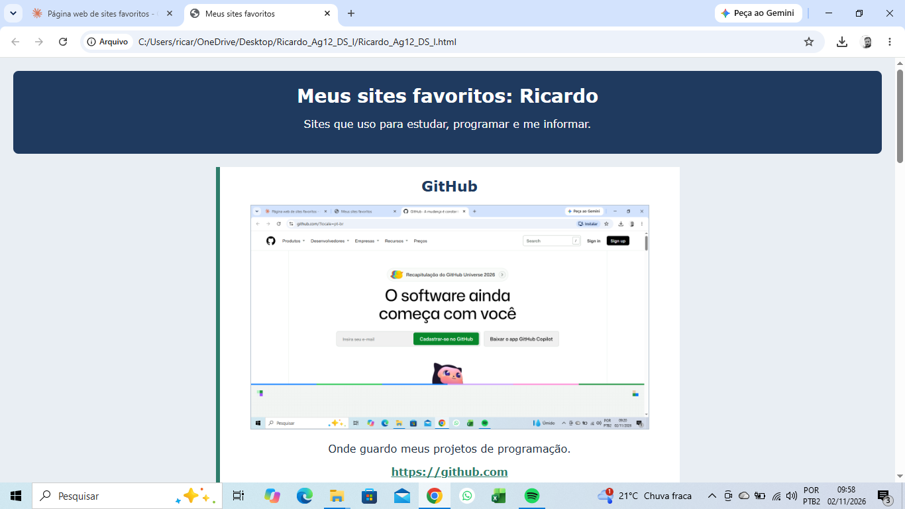
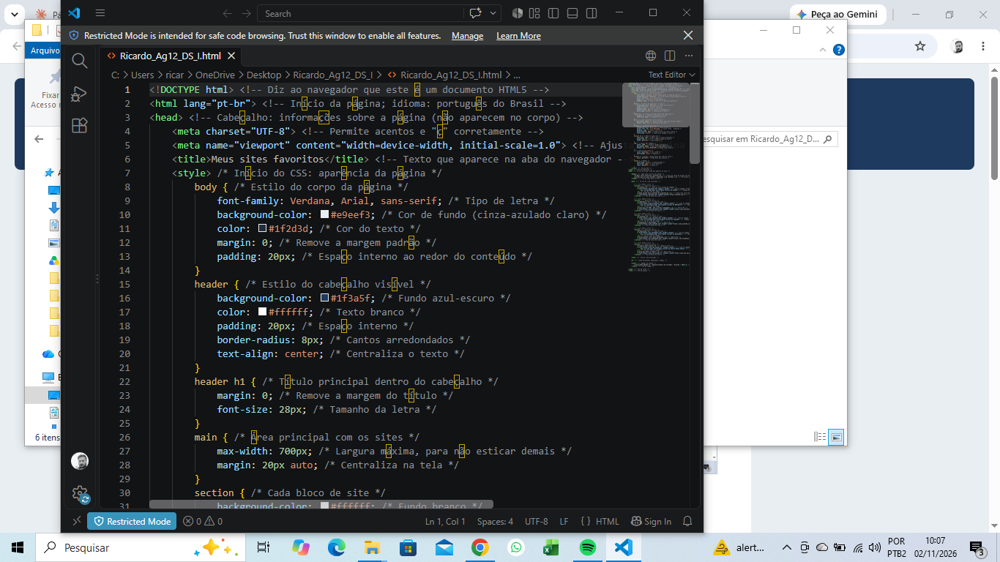

# Meus sites favoritos


## Sobre o projeto

Página web que reúne os meus sites favoritos, feita na **Agenda 12** do curso técnico de **Desenvolvimento de Sistemas**.

A página mostra cinco sites que uso para estudar, programar e me informar. Cada site tem o nome acima da imagem e o link abaixo dela. Clicar na imagem também abre o site em uma nova aba.

## Sites da página

| Site | Para que uso |
|------|--------------|
| [GitHub](https://github.com) | Guardar meus projetos de programação |
| [W3Schools](https://www.w3schools.com) | Tutoriais de HTML, CSS e outras linguagens |
| [YouTube](https://www.youtube.com) | Videoaulas e passatempo |
| [Wikipédia](https://pt.wikipedia.org) | Pesquisas |
| [Centro Paula Souza](https://www.cps.sp.gov.br) | Site das Etecs e Fatecs |

## Recursos usados

- Título da aba com `<title>`
- Nome de cada site com `<h1>`
- Imagens locais com `` e texto alternativo (`alt`)
- Links com `<a>`, abrindo em nova aba com `target="_blank"`
- Links também nas imagens
- Estrutura com `<header>`, `<main>`, `<section>` e `<footer>`
- Estilo com CSS (cores, bordas e layout que se ajusta ao celular)
- Comentários explicando cada linha do código

## Estrutura dos arquivos

```
Ricardo_Ag12_DS_I/
├── Ricardo_Ag12_DS_I.html   → página principal
├── github.png               → imagens dos sites
├── w3schools.png
├── youtube.png
├── wikipedia.png
├── cps.png
├── captura_navegador1.png   → página aberta no navegador
├── captura_navegador2.png
├── captura_codigo1.png      → código comentado
└── captura_codigo2.png
```

## Como abrir

1. Baixe o projeto em **Code → Download ZIP**.
2. Extraia a pasta.
3. Dê dois cliques no arquivo `Ricardo_Ag12_DS_I.html`.

## Capturas de tela

### Página no navegador



### Código comentado



## Autor

**Ricardo Queiroz Caetano**
Desenvolvimento de Sistemas, 2026

[](https://github.com/ricardocaetano203-bit)
